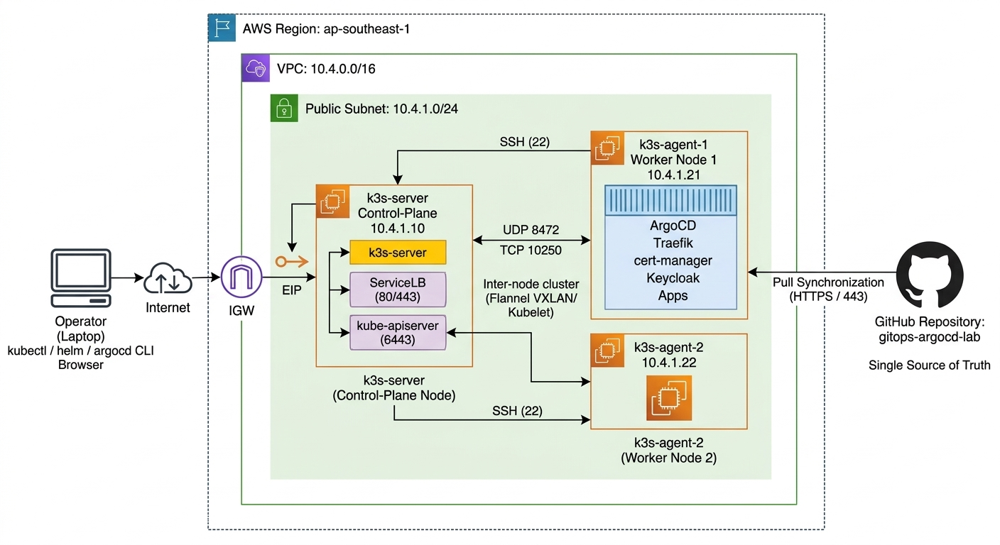

# gitops-argocd-lab

Praktikum **GitOps** menggunakan **ArgoCD** pada klaster **k3s** di **AWS (ap-southeast-1)**, dengan **Traefik**, **cert-manager (Let's Encrypt)**, dan **Keycloak SSO**. Seluruh infrastruktur dibuat oleh **Terraform** dan dapat dihapus bersih dengan `terraform destroy`.

Disusun oleh **Kanjeng Dhimas Cahyoherlina**.

---

## Daftar Isi

1. [Deskripsi Lab](#1-deskripsi-lab)
2. [Arsitektur Infrastruktur](#2-arsitektur-infrastruktur)
3. [Spesifikasi Infrastruktur AWS dan Keamanan Jaringan](#3-spesifikasi-infrastruktur-aws-dan-keamanan-jaringan)
4. [Rancangan Domain dan Sertifikat TLS](#4-rancangan-domain-dan-sertifikat-tls)
5. [Struktur Repositori](#5-struktur-repositori)
6. [Rancangan Kubernetes (k3s) dan ArgoCD](#6-rancangan-kubernetes-k3s-dan-argocd)
7. [Prasyarat dan Placeholder](#7-prasyarat-dan-placeholder)
8. [Langkah Setup dan Implementasi](#8-langkah-setup-dan-implementasi)
9. [Matriks Pengujian G-01 sampai G-20](#9-matriks-pengujian-g-01-sampai-g-20)
10. [Catatan Hasil Implementasi](#10-catatan-hasil-implementasi)
11. [Pembersihan Infrastruktur (Terraform Destroy)](#11-pembersihan-infrastruktur-terraform-destroy)
12. [Pemecahan Masalah](#12-pemecahan-masalah)
13. [Kesimpulan](#13-kesimpulan)
14. [Saran Pengembangan](#14-saran-pengembangan)
15. [Penutup](#15-penutup)

---

## 1. Deskripsi Lab

### 1.1 Tugas Praktikum

Case yang meminta empat hal pada klaster Kubernetes:

| No | Tugas | Implementasi pada lab ini |
|---|---|---|
| 1 | Deploy `simple-nginx` (`nginx:stable`) dan `simple-httpd` (`httpd:latest`) | Dua Deployment di namespace `demo`, dikelola ArgoCD |
| 2 | ConfigMap `index.html` yang di-mount ke document root | ConfigMap dari `configMapGenerator` Kustomize, di-mount dengan `subPath` ke `/usr/share/nginx/html/index.html` dan `/usr/local/apache2/htdocs/index.html` |
| 3 | Expose dengan Service (NodePort, port-forward, atau Ingress) | Ingress Traefik ber-HTTPS sebagai jalur utama. NodePort dan port-forward sebagai pembanding |
| 4 | Uji akses | `curl` dan browser menampilkan pesan yang diminta |

Teks halaman:

- NGINX: `Ini tampilan dari NGINX dan nama saya Kanjeng Dhimas Cahyoherlina`
- HTTPD: `Ini tampilan dari HTTPD dan nama saya Kanjeng Dhimas Cahyoherlina`

### 1.2 Tingkat Pengerjaan

Tugas inti dikembangkan menjadi platform GitOps bergaya production:

| Level | Cakupan |
|---|---|
| **Level 1 (inti tugas)** | Klaster Kubernetes, ArgoCD, ConfigMap `index.html`, Deployment, Service dan Ingress, uji akses |
| **Level 2 (production-style)** | Traefik dengan HTTPS (cert-manager), pola app-of-apps, AppProject, sync policy, drift detection, rolling update, rollback |
| **Level 3 (advanced)** | SSO ArgoCD dengan Keycloak, RBAC per grup, ApplicationSet multi-environment, validasi manifest di CI |

### 1.3 Keputusan Desain Utama

- **Biaya rendah**: seluruh node memakai **EC2 Spot Instance** di `ap-southeast-1`.
- **Kubernetes self-managed**: **k3s** pada 3 EC2 (1 server dan 2 agent).
- **ArgoCD sebagai satu-satunya jalur deploy**: setelah ArgoCD terpasang, platform dan aplikasi dikelola dari Git (pull-based), bukan dengan `kubectl apply` manual.
- **Infrastructure as Code**: VPC, Security Group, EC2, Elastic IP, kunci SSH, dan instalasi k3s dibuat Terraform.
- **Domain sendiri (Hostinger)**: akses lewat subdomain `gitops.<domain-anda>` dengan sertifikat publik Let's Encrypt. Pada lab ini dipakai `gitops.kanjeeng.online`.
- **Pembagian peran**: komponen pendukung diotomatisasi, inti GitOps dikerjakan manual dan terdokumentasi.

| Bagian | Cara | Peran |
|---|---|---|
| VPC, Security Group, 3 EC2 Spot, Elastic IP, kunci SSH | Otomatis (Terraform) | Infrastruktur pendukung |
| Instalasi k3s server dan agent (auto-join) | Otomatis (User Data) | Setup dasar klaster |
| Record DNS Hostinger | Manual (sekali) | Resolusi domain publik |
| Bootstrap ArgoCD | Manual | Komponen platform utama |
| AppProject, root app, platform, aplikasi tugas | Otomatis oleh ArgoCD (pull-based) | Inti tugas |
| NodePort, port-forward, rolling update, drift, rollback | Manual lewat commit Git | Inti eksplorasi |
| Keycloak SSO, ApplicationSet, CI | Manual dan GitOps | Opsional |

---

## 2. Arsitektur Infrastruktur



Diagram menggambarkan alur dari operator hingga *reconcile loop* ke GitHub:

1. **Operator** (laptop dengan `kubectl`, `helm`, `argocd` CLI, dan browser) terhubung lewat internet dan **Internet Gateway (IGW)** ke **Elastic IP** milik `k3s-server`.
2. **`k3s-server`** (`10.4.1.10`) adalah control-plane: `k3s-server`, `kube-apiserver` (6443), dan **ServiceLB** yang membuka port 80 dan 443 untuk Traefik.
3. **`k3s-agent-1`** (`10.4.1.21`) dan **`k3s-agent-2`** (`10.4.1.22`) adalah worker yang menjalankan ArgoCD, Traefik, cert-manager, Keycloak, dan aplikasi.
4. Antar node berkomunikasi lewat **Flannel VXLAN (UDP 8472)** dan **Kubelet (TCP 10250)**.
5. **ArgoCD** menarik (*pull*) repositori GitHub `gitops-argocd-lab` lewat HTTPS 443 sebagai *single source of truth*, membandingkan *live state* dengan *desired state*, lalu melakukan sinkronisasi.

Alur GitOps: operator melakukan `git push`, ArgoCD mendeteksi perbedaan, menerapkannya ke klaster, dan melaporkan status ke dashboard.

---

## 3. Spesifikasi Infrastruktur AWS dan Keamanan Jaringan

### 3.1 Jumlah EC2

Rancangan memakai **3 EC2** (1 control-plane dan 2 worker). Operator bekerja dari laptop.

| Opsi | Jumlah EC2 | Peruntukan | Catatan |
|---|---|---|---|
| Minimal | 1 (`t3.large`) | Level 1 dan sebagian Level 2 | Hemat, tetapi bukan klaster multi-node dan tidak cukup untuk Keycloak |
| **Rekomendasi (dipakai)** | **3** (`t3.medium` x 3) | Level 1 sampai 3 | Multi-node nyata, sebaran Pod seimbang, dapat menguji restart node |
| Diperluas | 4 (tambah ops-node) | Zero Trust lanjutan | Bastion agar port 6443 hanya dari dalam VPC |

### 3.2 Jaringan AWS

| Komponen | Nilai | Keterangan |
|---|---|---|
| Region | `ap-southeast-1` | Singapura |
| VPC | `10.4.0.0/16` | Tidak bertabrakan dengan CIDR Pod k3s (`10.42.0.0/16`) dan Service (`10.43.0.0/16`) |
| Public Subnet | `10.4.1.0/24` | Satu AZ cukup untuk lab |
| Internet Gateway dan Route Table | Rute `0.0.0.0/0` ke IGW | Unduh paket, image, dan tarik Git tanpa NAT Gateway |
| Elastic IP | 1 buah pada `k3s-server` | Target record DNS, `--tls-san` API, dan titik masuk Ingress |
| DNS | Subdomain `gitops.<domain-anda>` di Hostinger | Record A wildcard dibuat manual |
| Key pair SSH | Dibuat Terraform | Berkas `.pem` tidak masuk Git |

### 3.3 Spesifikasi Node (Ubuntu 24.04 LTS, Spot)

| No | Nama | IP privat | Tipe | vCPU / RAM | Disk | Peran |
|---|---|---|---|---|---|---|
| 1 | `k3s-server` | `10.4.1.10` + Elastic IP | t3.medium | 2 / 4 GiB | 30 GiB gp3 | Control-plane, endpoint API, ingress |
| 2 | `k3s-agent-1` | `10.4.1.21` | t3.medium | 2 / 4 GiB | 30 GiB gp3 | Worker |
| 3 | `k3s-agent-2` | `10.4.1.22` | t3.medium | 2 / 4 GiB | 30 GiB gp3 | Worker |

Estimasi kebutuhan memori (angka kasar):

| Komponen | RAM | Level |
|---|---|---|
| k3s server dan sistem (CoreDNS, metrics-server, local-path, ServiceLB) | 0,8 GiB | 1 |
| k3s agent (kubelet) x 2 | 0,6 GiB | 1 |
| ArgoCD (server, repo-server, controller, applicationset, redis) | 1,2 sampai 1,5 GiB | 1 |
| cert-manager dan Traefik | 0,3 sampai 0,5 GiB | 2 |
| simple-nginx dan simple-httpd | kurang dari 0,1 GiB | 1 |
| Keycloak dan PostgreSQL | 1,5 sampai 2 GiB | 3 |
| Prometheus dan Grafana (opsional) | 1,5 sampai 2 GiB | 3 |

Level 1 sampai 2 membutuhkan sekitar 4 GiB dari total 12 GiB klaster. Jika Keycloak dan monitoring dijalankan bersamaan, naikkan worker ke `t3.large`.

### 3.4 Strategi Spot, Penyimpanan, dan Akses

| Aspek | Rancangan |
|---|---|
| Spot | Tipe `persistent` dengan perilaku interupsi `stop`: instance berhenti (bukan terminated), disk EBS dan IP privat tetap |
| Control-plane | Default Spot. Variabel `use_spot = false` untuk On-Demand |
| Datastore | SQLite bawaan k3s pada EBS server |
| PVC | `local-path-provisioner` bawaan k3s |
| Akses admin | SSH dengan kunci. Opsi SSM Session Manager lewat variabel `enable_ssm` |
| Penghematan | Jalankan `terraform destroy` setelah selesai. IPv4 publik dan Elastic IP tetap ditagih per jam selama ada |

### 3.5 Security Group

Hanya port web 80 dan 443 yang terbuka ke publik. Port sensitif dibatasi ke `admin_cidr` (IP publik operator).

| Security Group | Port inbound | Sumber | Fungsi |
|---|---|---|---|
| `sg-k3s-server` | TCP 6443 | `admin_cidr` dan `sg-k3s-agent` | Kubernetes API (kubectl, join agent) |
| `sg-k3s-server` | TCP 22 | `admin_cidr` | SSH admin |
| `sg-k3s-server` | TCP 80, 443 | `0.0.0.0/0` | Web Traefik dan validasi ACME HTTP-01 |
| `sg-k3s-server` | TCP 30000-32767 | `admin_cidr` | NodePort (pengujian) |
| `sg-k3s-server` | UDP 8472, TCP 10250 | `sg-k3s-agent` | Flannel VXLAN dan kubelet |
| `sg-k3s-agent` | TCP 22 | `admin_cidr` | SSH admin |
| `sg-k3s-agent` | UDP 8472, TCP 10250 | `sg-k3s-server` dan `sg-k3s-agent` | Komunikasi antar node |
| `sg-k3s-agent` | TCP 30000-32767 | `admin_cidr` | NodePort pada worker |

Seluruh egress dibuka ke `0.0.0.0/0` agar node dapat mengunduh image dan menarik repositori GitHub.

### 3.6 Izin IAM Operator

| Kebijakan | Tujuan |
|---|---|
| `AmazonVPCFullAccess` | VPC, subnet, IGW, route table |
| `AmazonEC2FullAccess` | EC2 Spot, key pair, Elastic IP, Security Group |
| `IAMReadOnlyAccess` | Validasi identitas dengan `aws sts get-caller-identity` |
| Izin role dan instance profile (opsional) | Hanya jika `enable_ssm` diaktifkan |

---

## 4. Rancangan Domain dan Sertifikat TLS

Subdomain khusus `gitops.<domain-anda>` dipakai agar situs utama di Hostinger tidak terganggu. Sertifikat publik **Let's Encrypt** (cert-manager) menggantikan CA lab.

Record DNS dibuat manual di hPanel Hostinger:

| Tipe | Nama | Nilai | TTL |
|---|---|---|---|
| A | `*.gitops` | Elastic IP `k3s-server` | 300 |

Record wildcard ini menangani `argocd`, `nginx`, `httpd`, `keycloak`, dan `api` di bawah `gitops.<domain-anda>`.

| Nama host | Tujuan | Akses |
|---|---|---|
| `argocd.gitops.<domain-anda>` | Dashboard ArgoCD | Hanya `admin_cidr` |
| `nginx.gitops.<domain-anda>` | `simple-nginx` | Publik |
| `httpd.gitops.<domain-anda>` | `simple-httpd` | Publik |
| `keycloak.gitops.<domain-anda>` | Keycloak (Level 3) | Konsol admin hanya `admin_cidr`, endpoint OIDC terbuka |
| `api.gitops.<domain-anda>` | Kubernetes API | Port 6443 hanya `admin_cidr` |

Validasi sertifikat memakai **ACME HTTP-01**. Penerbitan dua tahap: ClusterIssuer `letsencrypt-staging` untuk uji (menghindari *rate limit*), lalu `letsencrypt-prod`. Pengalihan ke production dilakukan lewat commit Git.

---

## 5. Struktur Repositori

```
gitops-argocd-lab/
├── README.md
├── .gitignore
├── terraform/                      # IaC AWS dan instalasi k3s
│   ├── versions.tf  providers.tf  variables.tf  terraform.tfvars.example
│   ├── network.tf  security-groups.tf  keypair.tf  k3s-token.tf  iam.tf
│   ├── ec2.tf  outputs.tf
│   └── userdata/{k3s-server.sh,k3s-agent.sh}
├── bootstrap/                      # Nilai Helm ArgoCD (bootstrap dan SSO)
├── argocd/
│   ├── projects/                   # AppProject: platform, demo-project
│   ├── root-app.yaml               # App-of-apps Level 1 dan 2
│   ├── root-app-level3.yaml        # App-of-apps Level 3
│   ├── applications/               # Application per komponen dan aplikasi
│   ├── level3/                     # Keycloak dan ApplicationSet
│   └── tests/forbidden-app.yaml    # Uji penolakan AppProject (G-17)
├── platform/
│   ├── cert-manager/{values.yaml,issuers/}
│   ├── traefik/values.yaml
│   ├── argocd/                     # Ingress dan middleware allowlist dashboard
│   └── keycloak/                   # Keycloak dan PostgreSQL (Level 3)
├── apps/
│   ├── simple-nginx/{base,overlays/{dev,dev-nodeport,prod}}
│   └── simple-httpd/{base,overlays/{dev,dev-nodeport,prod}}
├── .github/workflows/validate.yaml # CI validasi manifest (Level 3)
└── docs/screenshots/               # Screenshot bukti (termasuk gitops.jpg)
```

### 5.1 Terraform (`terraform/`)

| Berkas | Fungsi |
|---|---|
| `versions.tf`, `providers.tf` | Terraform minimal 1.5.0, provider `aws`, `tls`, `local`, `random`, dan *default tags* |
| `variables.tf` | Variabel input: `admin_cidr`, `base_domain`, `letsencrypt_email` (wajib), `use_spot`, `k3s_version`, `existing_eip_allocation_id`, `enable_ssm` (opsional) |
| `network.tf` | VPC, public subnet, Internet Gateway, route table |
| `security-groups.tf` | `sg-k3s-server` dan `sg-k3s-agent`. Aturan sebagai resource terpisah agar referensi silang tidak membentuk siklus |
| `keypair.tf` | Kunci SSH otomatis dan berkas `gitops-lab-key.pem` (izin 0400) |
| `k3s-token.tf` | Token klaster acak untuk join otomatis |
| `iam.tf` | Role dan instance profile SSM (hanya jika `enable_ssm = true`) |
| `ec2.tf` | AMI Ubuntu 24.04, Elastic IP (baru atau yang sudah ada), 1 server dan 2 agent dengan IP privat tetap |
| `outputs.tf` | Elastic IP, perintah SSH, alamat API, ID instance, instruksi record DNS |
| `userdata/k3s-server.sh` | Instal k3s server: Traefik bawaan dimatikan, `--tls-san` untuk Elastic IP dan `api.<domain>`, `--node-ip 10.4.1.10` |
| `userdata/k3s-agent.sh` | Menunggu `/ping` server di port 6443, lalu join sebagai agent dengan token yang sama |

### 5.2 Bootstrap dan ArgoCD

| Berkas | Fungsi |
|---|---|
| `bootstrap/argocd-values.yaml` | Instalasi ArgoCD: `server.insecure`, URL dashboard, batas sumber daya, Dex dan notifikasi dimatikan |
| `bootstrap/argocd-values-sso.yaml` | OIDC Keycloak dan pemetaan grup ke RBAC. Client secret tidak ada di berkas ini |
| `argocd/projects/platform.yaml` | AppProject platform (sumber dan tujuan bebas) |
| `argocd/projects/demo-project.yaml` | AppProject aplikasi: hanya repo ini, hanya namespace `demo*`, resource klaster hanya Namespace |
| `argocd/root-app.yaml` | Application induk (app-of-apps) menunjuk `argocd/applications/` |
| `argocd/applications/*.yaml` | Satu Application per komponen. Urutan lewat *sync wave* |
| `argocd/root-app-level3.yaml`, `argocd/level3/` | Keycloak (wave 5) dan ApplicationSet `demo-prod` |
| `argocd/tests/forbidden-app.yaml` | Application uji yang menargetkan `kube-system` |

### 5.3 Platform dan Aplikasi

| Berkas | Fungsi |
|---|---|
| `platform/cert-manager/values.yaml` | Nilai Helm cert-manager (CRD ikut dipasang) |
| `platform/cert-manager/issuers/` | ClusterIssuer Let's Encrypt `staging` dan `prod` (solver HTTP-01 lewat Traefik) |
| `platform/traefik/values.yaml` | Pod dipin ke `k3s-server`, Service `LoadBalancer` dengan `externalTrafficPolicy: Local`, provider Ingress dan CRD, `publishedService` |
| `platform/argocd/` | Middleware IP allowlist dan Ingress dashboard ArgoCD |
| `platform/keycloak/` | Keycloak 26 dan PostgreSQL 16, middleware allowlist, dua Ingress (admin dibatasi, OIDC terbuka) |
| `apps/*/base/` | `index.html`, `configMapGenerator`, Deployment (2 replika, probe, topology spread, `subPath`), Service `ClusterIP` |
| `apps/*/overlays/dev/` | Namespace `demo` dan Ingress Traefik ber-TLS (jalur utama) |
| `apps/*/overlays/dev-nodeport/` | Mengubah Service menjadi NodePort (30080 dan 30081) |
| `apps/*/overlays/prod/` | Namespace `demo-prod` dengan host `*-prod` untuk ApplicationSet |
| `.github/workflows/validate.yaml` | `kustomize build` dan validasi `kubeconform` pada Pull Request |

---

## 6. Rancangan Kubernetes (k3s) dan ArgoCD

### 6.1 Alasan Memilih k3s

| Opsi | Kelebihan | Kekurangan untuk proyek ini |
|---|---|---|
| minikube / kind | Sangat mudah | Satu mesin lokal, bukan multi-node AWS |
| kubeadm | Standar upstream, mirip production | Instalasi panjang, boros RAM, risiko salah konfigurasi |
| Amazon EKS | Managed, standar industri | Biaya control-plane tetap, NAT dan Load Balancer kurang efisien untuk praktikum |
| **k3s (dipakai)** | Tersertifikasi CNCF, satu binary, ringan, CNI, ingress, storage, dan service LB bawaan | Bukan managed, control-plane tunggal tidak HA |

### 6.2 Komponen Bawaan k3s

| Komponen | Keputusan |
|---|---|
| Flannel (VXLAN) | Dipakai |
| CoreDNS, metrics-server | Dipakai |
| local-path-provisioner | Dipakai (PVC lab) |
| ServiceLB (klipper-lb) | Dipakai: membuka port 80 dan 443 pada node untuk Traefik |
| Traefik bawaan | **Dimatikan** (`--disable traefik`). Dipasang lewat ArgoCD agar versi dan konfigurasinya masuk Git |

### 6.3 Alur Instalasi k3s (otomatis lewat User Data)

| Langkah | Proses |
|---|---|
| 1 | Terraform membuat token acak yang dibagikan ke server dan agent |
| 2 | Server menjalankan skrip resmi `get.k3s.io` dengan versi dipin, `--disable traefik`, `--tls-san <Elastic IP>`, `--tls-san api.gitops.<domain-anda>`, `--node-ip 10.4.1.10`, `--write-kubeconfig-mode 644` |
| 3 | Service `k3s` aktif, API di port 6443, kubeconfig di `/etc/rancher/k3s/k3s.yaml` |
| 4 | Agent menunggu API server, lalu join dengan `K3S_URL=https://10.4.1.10:6443` dan token yang sama |
| 5 | `kubectl get nodes` menampilkan 3 node `Ready` |

### 6.4 Sync Waves dan Kebijakan Sinkronisasi

| Wave | Application | Isi |
|---|---|---|
| 0 | `projects` | AppProject |
| 1 | `cert-manager` | Helm chart cert-manager dan CRD |
| 2 | `cert-manager-config` | ClusterIssuer Let's Encrypt (staging dan production) |
| 3 | `traefik` | Helm chart Traefik |
| 4 | `argocd-ingress`, `simple-nginx`, `simple-httpd` | Ingress dashboard dan aplikasi tugas |
| 5 | `keycloak` (Level 3) | Keycloak dan PostgreSQL |

| Kebijakan | Nilai | Tujuan |
|---|---|---|
| `automated` | Aktif | Perubahan di Git langsung diterapkan |
| `prune` | Aktif pada aplikasi, nonaktif pada platform | Platform terlindung dari penghapusan tidak sengaja |
| `selfHeal` | Aktif | Drift dikembalikan sesuai Git |
| `retry` dengan backoff | Aktif | Mengatasi urutan CRD dan jaringan yang belum siap |
| Polling | 3 menit | Dipercepat dengan `argocd app get <nama> --refresh` |

---

## 7. Prasyarat dan Placeholder

### 7.1 Alat di Laptop Operator

| Kebutuhan | Cek dengan |
|---|---|
| AWS CLI dan akun AWS | `aws --version` |
| Terraform 1.5 atau lebih baru | `terraform version` |
| kubectl | `kubectl version --client` |
| Helm 3 | `helm version` |
| ArgoCD CLI | `argocd version --client` |
| Git dan akun GitHub | `git --version` |
| Klien SSH dan SCP | `ssh -V` |
| Editor dengan *Replace in Files* (misalnya VS Code) | Mengganti placeholder |
| Domain di Hostinger | Akses hPanel |

Seluruh perintah ditulis satu baris agar kompatibel dengan Linux, macOS, dan Windows PowerShell. Pada PowerShell gunakan `curl.exe` (bukan `curl`) dan `Copy-Item` sebagai pengganti `cp`.

Alat CLI dipasang di laptop (bukan di EC2) karena konsep *remote management*: EC2 adalah infrastruktur, laptop adalah stasiun kendali. `kubectl` membaca kubeconfig dari EC2 untuk memantau klaster dan membuat Secret sensitif tanpa menyimpannya di Git. `helm` memasang ArgoCD pada fase bootstrap. `argocd` CLI mempermudah login, pendaftaran repositori, dan sinkronisasi manual.

### 7.2 Placeholder yang Wajib Diganti

Ganti sebelum `git push` dan jangan commit nilai pribadi yang tidak perlu.

| Placeholder | Ganti dengan | Berkas |
|---|---|---|
| `gitops.example.com` | Subdomain lab (pada lab ini `gitops.kanjeeng.online`) | `terraform/terraform.tfvars.example`, `bootstrap/argocd-values.yaml`, `bootstrap/argocd-values-sso.yaml`, `platform/argocd/ingress.yaml`, `platform/keycloak/ingress.yaml`, `apps/simple-nginx/overlays/{dev,prod}/ingress.yaml`, `apps/simple-httpd/overlays/{dev,prod}/ingress.yaml` |
| `admin@example.com` | Email aktif untuk Let's Encrypt | `platform/cert-manager/issuers/letsencrypt-staging.yaml`, `letsencrypt-prod.yaml` |
| `YOUR_GITHUB_USER` | Username GitHub (pada lab ini `kanjeeng`) | `argocd/root-app.yaml`, `argocd/root-app-level3.yaml`, seluruh `argocd/applications/*.yaml`, `argocd/level3/*.yaml`, `argocd/projects/demo-project.yaml`, `argocd/tests/forbidden-app.yaml` |
| `203.0.113.10/32` | IP publik operator dalam format CIDR | `terraform/terraform.tfvars.example`, `platform/argocd/middleware-admin-allowlist.yaml`, `platform/keycloak/middleware-admin-allowlist.yaml` |

IP publik operator dapat dilihat di https://checkip.amazonaws.com.

---

## 8. Langkah Setup dan Implementasi

Prinsip kerja: seluruh perubahan konfigurasi dilakukan lewat `git push`, bukan `kubectl apply` manual. Perintah `kubectl` hanya untuk inspeksi, pengujian, dan pembuatan Secret yang tidak boleh masuk Git.

### Tahap 1: Persiapan dan Provisioning Infrastruktur

**Langkah 1. Verifikasi alat** `[laptop]`

```
aws --version
terraform version
kubectl version --client
helm version
argocd version --client
git --version
```

**Langkah 2. Konfigurasi dan verifikasi AWS CLI** `[laptop]`

```
aws configure
aws sts get-caller-identity
```

Isi Access Key ID, Secret Access Key, region `ap-southeast-1`, dan format `json`. Hasil: akun, ARN, dan User ID tampil.

**Langkah 3. Inisialisasi repositori Git** `[laptop]`

```
cd gitops-argocd-lab
git init
```

**Langkah 4 dan 5. Ganti dan validasi placeholder** `[editor dan laptop]`

Gunakan *Replace in Files* untuk keempat placeholder pada tabel 7.2, lalu verifikasi:

```
git grep --untracked -n -E "example.com|YOUR_GITHUB_USER|203.0.113.10"
```

Hasil: tidak ada baris yang tampil.

**Langkah 6. Variabel Terraform** `[laptop]`

```
cd terraform
cp terraform.tfvars.example terraform.tfvars
```

Isi `admin_cidr`, `base_domain`, dan `letsencrypt_email`. Opsional: `existing_eip_allocation_id` bila memakai Elastic IP yang sudah dialokasikan.

**Langkah 7. Inisialisasi, validasi, dan rencana** `[laptop, folder terraform]`

```
terraform init
terraform validate
terraform plan
```

Hasil: `Success! The configuration is valid.` dan rencana pembuatan 3 EC2, 1 Elastic IP, 2 Security Group beserta aturannya, VPC, subnet, IGW, route table, key pair, dan berkas `.pem`.

**Langkah 8 dan 9. Terapkan infrastruktur dan catat output** `[laptop, folder terraform]`

```
terraform apply --auto-approve
terraform output
```

Catat `elastic_ip`, `ssh_server`, `dns_instruction`, dan `instance_ids`. Pada Linux atau macOS, jika SSH menolak izin berkas kunci: `chmod 400 gitops-lab-key.pem`.

**Langkah 10. Verifikasi bootstrap k3s** `[laptop lalu k3s-server]`

Tunggu 3 sampai 5 menit, lalu:

```
ssh -i gitops-lab-key.pem ubuntu@<elastic_ip>
```

Di dalam server:

```
cloud-init status --wait
sudo systemctl status k3s --no-pager
kubectl get nodes
```

Hasil: `status: done`, layanan `k3s` `active (running)`, dan 3 node `Ready` (`k3s-server`, `k3s-agent-1`, `k3s-agent-2`). Ketik `exit`.

### Tahap 2: Konfigurasi DNS di Hostinger

**Langkah 11. Record A wildcard** `[hPanel Hostinger]`

Masuk hPanel, pilih domain, buka **DNS / Nameservers** lalu **DNS records**, dan tambahkan:

| Tipe | Nama | Nilai | TTL |
|---|---|---|---|
| A | `*.gitops` | `<elastic_ip>` | 300 |

Kolom nama diisi relatif terhadap domain utama. Jika `base_domain` adalah `gitops.kanjeeng.online`, cukup `*.gitops`.

**Langkah 12. Verifikasi DNS (uji G-19)** `[laptop]`

```
nslookup argocd.gitops.<domain-anda>
nslookup nginx.gitops.<domain-anda>
nslookup api.gitops.<domain-anda>
```

Hasil: ketiganya mengarah ke Elastic IP. Jika belum, tunggu propagasi (TTL 300 detik) lalu ulangi. **Jangan membuat Ingress ber-TLS sebelum langkah ini berhasil.**

### Tahap 3: Akses Klaster dari Laptop

**Langkah 13. Salin kubeconfig** `[laptop, folder terraform]`

```
scp -i gitops-lab-key.pem ubuntu@<elastic_ip>:/etc/rancher/k3s/k3s.yaml k3s.yaml
```

Berkas `k3s.yaml` bersifat rahasia dan sudah dikecualikan oleh `.gitignore`.

**Langkah 14. Ubah alamat server pada kubeconfig** `[editor]`

Ganti `server: https://127.0.0.1:6443` menjadi `server: https://api.gitops.<domain-anda>:6443`. Valid karena sertifikat API memuat `api.<base_domain>` pada `--tls-san`.

**Langkah 15. Pasang kubeconfig** `[laptop]`

Linux atau macOS:

```
mkdir -p ~/.kube
[ -f ~/.kube/config ] && cp ~/.kube/config ~/.kube/config.bak
cp k3s.yaml ~/.kube/config
```

Windows PowerShell:

```
if (!(Test-Path "$HOME\.kube")) { New-Item -ItemType Directory -Force -Path "$HOME\.kube" }
if (Test-Path "$HOME\.kube\config") { Copy-Item "$HOME\.kube\config" "$HOME\.kube\config.bak" }
Copy-Item k3s.yaml "$HOME\.kube\config"
```

Alternatif tanpa menimpa: tambahkan `--kubeconfig k3s.yaml` pada setiap perintah `kubectl` dan `helm`.

**Langkah 16. Verifikasi klaster (uji G-01)** `[laptop]`

```
kubectl get nodes -o wide
kubectl get pods -A
```

Hasil: 3 node `Ready` dengan IP internal `10.4.1.10`, `10.4.1.21`, `10.4.1.22`. Pod sistem (`coredns`, `metrics-server`, `local-path-provisioner`, `svclb`) `Running`. Traefik bawaan tidak ada karena sengaja dimatikan.

### Tahap 4: Instalasi ArgoCD

ArgoCD dipasang dengan Helm memakai `bootstrap/argocd-values.yaml`: mode `server.insecure` (TLS diterminasi di Traefik), batas sumber daya kecil, Dex dan notifikasi dimatikan.

**Langkah 17. Tambah repositori Helm** `[laptop, folder utama repositori]`

```
helm repo add argo https://argoproj.github.io/argo-helm
helm repo update
helm search repo argo/argo-cd --versions
```

Pastikan chart `7.7.0` tersedia. Jika tidak, pilih versi terdekat dan pakai nomor yang sama pada langkah berikutnya.

**Langkah 18. Instal ArgoCD** `[laptop]`

```
helm install argocd argo/argo-cd --version 7.7.0 --namespace argocd --create-namespace -f bootstrap/argocd-values.yaml
```

**Langkah 19. Verifikasi Pod (uji G-02)** `[laptop]`

```
kubectl -n argocd rollout status deploy/argocd-server
kubectl -n argocd get pods
```

Hasil: `argocd-server`, `argocd-repo-server`, `argocd-application-controller`, `argocd-applicationset-controller`, dan `argocd-redis` `Running`. Dex dan notifikasi tidak ada.

**Langkah 20. Akses awal dengan port-forward** `[laptop, terminal terpisah]`

```
kubectl -n argocd port-forward svc/argocd-server 8080:80
```

Biarkan berjalan, lalu buka `http://localhost:8080`.

**Langkah 21. Password awal dan login UI (uji G-03)** `[laptop]`

```
argocd admin initial-password -n argocd
```

Login dengan username `admin` dan password tersebut.

**Langkah 22. Login CLI, ganti password, hapus Secret awal** `[laptop]`

```
argocd login localhost:8080 --username admin --plaintext
argocd account update-password
kubectl -n argocd delete secret argocd-initial-admin-secret
```

### Tahap 5: Bootstrap GitOps

**Langkah 23. Repositori GitHub dan push** `[browser dan laptop]`

Buat repositori **publik** `gitops-argocd-lab` tanpa README awal. Lalu:

```
git add .
git status
git commit -m "Initial commit gitops-argocd-lab"
git branch -M main
git remote add origin https://github.com/<username>/gitops-argocd-lab.git
git push -u origin main
```

Sebelum commit, pastikan berkas `.pem`, `terraform.tfvars`, `tfstate`, dan `k3s.yaml` **tidak** muncul pada `git status`. Jika muncul, batalkan dan periksa `.gitignore`.

**Langkah 24. Daftarkan repositori ke ArgoCD** `[laptop]`

```
argocd repo add https://github.com/<username>/gitops-argocd-lab.git
argocd repo list
```

Repositori publik tidak membutuhkan kredensial. Hasil: status `Successful`.

**Langkah 25. Terapkan AppProject** `[laptop]`

```
kubectl apply -f argocd/projects/
argocd proj list
```

Hasil: `platform` dan `demo-project` terdaftar. Ini bootstrap manual agar root Application memiliki project tujuan yang valid.

**Langkah 26. Terapkan root Application (app-of-apps)** `[laptop]`

```
kubectl apply -f argocd/root-app.yaml
kubectl -n argocd get applications -w
```

Tekan `Ctrl+C` setelah semua Application terbentuk. Root app membangun Application anak berurutan menurut *sync wave* (0 `projects`, 1 `cert-manager`, 2 `cert-manager-config`, 3 `traefik`, 4 `argocd-ingress`, `simple-nginx`, `simple-httpd`). Beberapa Application sempat `Progressing` atau `Degraded` saat dependensi belum siap dan pulih sendiri berkat `retry`.

### Tahap 6: Platform dan HTTPS

Tahap ini dijalankan ArgoCD dari Git. Peran operator hanya memantau dan memverifikasi.

**Langkah 27. Pantau seluruh Application** `[laptop]`

```
argocd app list
```

Hasil: seluruh Application `Synced` dan `Healthy` (tujuh kartu aplikasi di dashboard).

**Langkah 28. Verifikasi cert-manager dan ClusterIssuer** `[laptop]`

```
kubectl -n cert-manager get pods
kubectl get clusterissuer
```

Hasil: tiga Pod `Running`, `letsencrypt-staging` dan `letsencrypt-prod` `READY True`.

**Langkah 29. Verifikasi Traefik** `[laptop]`

```
kubectl -n traefik get pods,svc -o wide
kubectl get ingressclass
```

Hasil: Pod Traefik di `k3s-server`, Service `LoadBalancer` dengan `EXTERNAL-IP` terisi, IngressClass `traefik`.

**Langkah 30. Sertifikat dan Ingress dashboard ArgoCD** `[laptop]`

```
kubectl -n argocd get ingress,certificate
```

Tunggu `READY True`. Jika lama: `kubectl get order,challenge -A`. Buka `https://argocd.gitops.<domain-anda>`. Browser menampilkan peringatan karena sertifikat masih dari issuer *staging* (normal).

**Langkah 31. Promosi Ingress ArgoCD ke issuer production (lewat Git, uji G-12)** `[editor dan laptop]`

Ubah anotasi `cert-manager.io/cluster-issuer` di `platform/argocd/ingress.yaml` dari `letsencrypt-staging` menjadi `letsencrypt-prod`, lalu:

```
git add platform/argocd/ingress.yaml
git commit -m "Ingress ArgoCD memakai issuer production"
git push
```

Jika sertifikat staging tidak terganti: `kubectl -n argocd delete secret argocd-tls`. Hasil: dashboard terbuka tanpa peringatan browser dengan gembok HTTPS valid.

**Langkah 32. Login CLI lewat domain** `[laptop]`

```
argocd login argocd.gitops.<domain-anda> --grpc-web
```

Flag `--grpc-web` wajib agar gRPC melewati Traefik. Port-forward pada langkah 20 dapat dihentikan.

### Tahap 7: Aplikasi Tugas dan Uji Akses

Aplikasi sudah dibuat ArgoCD pada wave 4 dari overlay `dev` (namespace `demo`).

**Langkah 33. Verifikasi ConfigMap, Deployment, Service, Ingress (uji G-05, G-06, G-07)** `[laptop]`

```
kubectl -n demo get configmap,deploy,pods,svc,ingress
kubectl -n demo get configmap -o yaml
```

Hasil: dua ConfigMap berakhiran hash (`simple-nginx-index-xxxxx`, `simple-httpd-index-xxxxx`) berisi teks sesuai soal, dua Deployment 2/2, empat Pod `Running`, dua Service `ClusterIP`, dan dua Ingress. Pada dashboard ArgoCD, periksa *Resource Tree* (ConfigMap, Deployment, ReplicaSet, Pod, Service, Ingress) berstatus `Synced` dan `Healthy`.

**Langkah 34. Verifikasi mount ke document root** `[laptop]`

```
kubectl -n demo exec deploy/simple-nginx -- cat /usr/share/nginx/html/index.html
kubectl -n demo exec deploy/simple-nginx -- ls /usr/share/nginx/html
kubectl -n demo exec deploy/simple-httpd -- cat /usr/local/apache2/htdocs/index.html
```

Hasil: `cat` menampilkan pesan tugas. `ls` masih menampilkan berkas bawaan seperti `50x.html`, membuktikan `subPath` hanya menimpa satu berkas.

**Langkah 35. Verifikasi sebaran Pod** `[laptop]`

```
kubectl -n demo get pods -o wide
```

**Langkah 36. Uji akses dengan sertifikat staging (uji G-08, G-09)** `[laptop]`

```
curl -k https://nginx.gitops.<domain-anda>
curl -k https://httpd.gitops.<domain-anda>
```

Hasil: `Ini tampilan dari NGINX dan nama saya Kanjeng Dhimas Cahyoherlina` dan `Ini tampilan dari HTTPD dan nama saya Kanjeng Dhimas Cahyoherlina`.

**Langkah 37. Promosi Ingress aplikasi ke issuer production dan uji akhir** `[editor dan laptop]`

Ubah anotasi `cert-manager.io/cluster-issuer` menjadi `letsencrypt-prod` pada `apps/simple-nginx/overlays/dev/ingress.yaml` dan `apps/simple-httpd/overlays/dev/ingress.yaml`:

```
git add apps
git commit -m "Ingress aplikasi memakai issuer production"
git push
kubectl -n demo get certificate
```

Jika lama, hapus Secret lama agar diterbitkan ulang: `kubectl -n demo delete secret simple-nginx-tls simple-httpd-tls`. Uji tanpa `-k`:

```
curl https://nginx.gitops.<domain-anda>
curl https://httpd.gitops.<domain-anda>
curl -I http://nginx.gitops.<domain-anda>
```

Hasil: kedua halaman tampil dengan sertifikat valid. Permintaan HTTP pada port 80 mengembalikan `404 Not Found`, karena rute port 80 tidak didaftarkan pada Ingress aplikasi (Ingress hanya memakai entrypoint `websecure`). Akses aplikasi selalu memakai `https://`. Buka kedua alamat di browser.

### Tahap 8: Eksplorasi GitOps

ArgoCD memeriksa repositori setiap 3 menit. Percepat dengan `argocd app get <nama-app> --refresh`.

**Langkah 38. Metode NodePort (uji G-10)** `[editor dan laptop]`

Ubah `path` pada `argocd/applications/simple-nginx.yaml` dan `simple-httpd.yaml` dari `overlays/dev` menjadi `overlays/dev-nodeport`:

```
git add argocd
git commit -m "Uji NodePort"
git push
kubectl -n demo get svc
curl http://<elastic_ip>:30080
curl http://<elastic_ip>:30081
```

Hasil: Service bertipe `NodePort` (30080 dan 30081) dan halaman tampil lewat Elastic IP. Port NodePort hanya terbuka dari `admin_cidr`. Kembalikan konfigurasi:

```
git revert HEAD --no-edit
git push
```

**Langkah 39. Metode port-forward (uji G-11)** `[laptop]`

```
kubectl -n demo port-forward svc/simple-nginx 8081:80
```

Pada terminal lain: `curl http://localhost:8081`. Hentikan dengan `Ctrl+C`.

**Langkah 40. Ubah ConfigMap dan amati rolling update (uji G-13)** `[editor dan laptop]`

Ubah teks pada `apps/simple-nginx/base/index.html` (misalnya tambahkan `versi 2`), lalu:

```
git add apps
git commit -m "Ubah teks halaman nginx"
git push
kubectl -n demo get pods -w
```

Pada terminal lain:

```
kubectl -n demo get configmap
kubectl -n demo rollout history deploy/simple-nginx
curl https://nginx.gitops.<domain-anda>
```

Hasil: ArgoCD menyinkronkan otomatis, ConfigMap baru dengan hash berbeda dibuat, Pod diganti bertahap (*rolling update*), dan halaman menampilkan teks baru. Ini terjadi karena `configMapGenerator` mengubah nama ConfigMap saat isinya berubah sehingga mount `subPath` ikut diperbarui.

**Langkah 41. Uji drift dan self-heal (uji G-14)** `[laptop]`

```
kubectl -n demo scale deploy/simple-nginx --replicas=5
kubectl -n demo get deploy simple-nginx -w
kubectl -n demo delete svc simple-httpd
kubectl -n demo get svc
```

Hasil: ArgoCD mendeteksi `OutOfSync`, lalu `selfHeal` mengembalikan replika menjadi 2 dan membuat ulang Service `simple-httpd`.

**Langkah 42. Rollback lewat `git revert` (uji G-15)** `[laptop]`

```
git log --oneline
git revert <id-commit-perubahan-teks> --no-edit
git push
curl https://nginx.gitops.<domain-anda>
argocd app history simple-nginx
```

Perintah `argocd app rollback simple-nginx <id-riwayat>` **ditolak** selama *auto-sync* aktif, sehingga rollback yang benar pada GitOps dilakukan dengan `git revert`.

### Tahap 9: Level 3 Advanced (opsional)

**Langkah 43. Cek kapasitas memori** `[laptop]`

```
kubectl top nodes
```

Jika memori hampir penuh, naikkan `agent_instance_type` ke `t3.large` lalu `terraform apply`, atau lewati Keycloak dan pakai Dex.

**Langkah 44. Namespace dan Secret Keycloak (tidak disimpan di Git)** `[laptop]`

```
kubectl create namespace keycloak
kubectl -n keycloak create secret generic keycloak-secrets \
  --from-literal=db-user=keycloak \
  --from-literal=db-password=<password-db> \
  --from-literal=admin-user=admin \
  --from-literal=admin-password=<password-admin>
```

Gunakan password yang kuat. Pada PowerShell, tulis perintah dalam satu baris tanpa tanda `\`.

**Langkah 45. Root Application Level 3** `[laptop]`

```
kubectl apply -f argocd/root-app-level3.yaml
kubectl -n keycloak get pods -w
```

Hasil: `root-level3` meluncurkan `keycloak` (wave 5) dan ApplicationSet `demo-prod`. Pod `keycloak-db-0` dan `keycloak` `Running` dalam 2 sampai 4 menit.

**Langkah 46. Promosi Ingress Keycloak ke production** `[editor dan laptop]`

Ubah anotasi `cert-manager.io/cluster-issuer` pada Ingress `keycloak-public` di `platform/keycloak/ingress.yaml` menjadi `letsencrypt-prod`, lalu commit dan push.

```
kubectl -n keycloak get ingress,certificate
```

Buka `https://keycloak.gitops.<domain-anda>/admin` dari jaringan operator (`admin_cidr`) dan login dengan kredensial admin dari langkah 44.

**Langkah 47. Konfigurasi Keycloak untuk ArgoCD** `[browser]`

| No | Tindakan |
|---|---|
| 1 | Buat realm `gitops` |
| 2 | Buat grup `argocd-admins` dan `argocd-viewers` (pada lab ini juga `argocd-developers`) |
| 3 | Buat dua pengguna uji dengan password, masukkan masing-masing ke grup |
| 4 | Buat client OIDC `argocd`. Daftarkan *Valid redirect URIs* `https://argocd.gitops.<domain-anda>/auth/callback` dan `http://localhost:8085/auth/callback` (untuk login SSO via CLI), serta *Web origins* `https://argocd.gitops.<domain-anda>`. Pastikan mode client (*Confidential* atau *Public* dengan PKCE) selaras dengan cara login dan ada tidaknya client secret di ArgoCD (lihat bagian 10) |
| 5 | Buat *client scope* `groups` (tipe *Default*) dengan mapper *Group Membership*: nama klaim `groups`, *Full group path* dimatikan, ditambahkan ke ID token dan access token |
| 6 | Tambahkan scope `groups` ke client `argocd` |
| 7 | Salin *Client secret* dari tab *Credentials* (jika client bertipe *Confidential*) |

**Langkah 48. Simpan client secret ke ArgoCD (tidak ke Git)** `[laptop]`

Buat berkas lokal `secret-patch.json` (diabaikan Git):

```
{
  "stringData": {
    "oidc.keycloak.clientSecret": "<client_secret_dari_langkah_47>"
  }
}
```

Terapkan (membutuhkan kubectl 1.31 atau lebih baru), lalu hapus berkasnya:

```
kubectl -n argocd patch secret argocd-secret --type merge --patch-file secret-patch.json
rm secret-patch.json
```

**Langkah 49. Aktifkan SSO pada ArgoCD** `[laptop]`

```
helm upgrade argocd argo/argo-cd --version 7.7.0 -n argocd -f bootstrap/argocd-values.yaml -f bootstrap/argocd-values-sso.yaml
kubectl -n argocd rollout restart deploy/argocd-server
```

**Langkah 50. Uji login SSO dan RBAC (uji G-16)** `[browser]`

Buka `https://argocd.gitops.<domain-anda>`, klik **LOG IN VIA KEYCLOAK**. Login sebagai anggota `argocd-admins`: seluruh aplikasi dapat dikelola. Login sebagai anggota `argocd-viewers`: aplikasi terlihat, tetapi *Sync* dan aksi perubahan ditolak.

**Langkah 51. Nonaktifkan akun admin lokal** `[editor dan laptop]`

Setelah SSO dan RBAC terbukti, ubah `admin.enabled` pada `bootstrap/argocd-values-sso.yaml` menjadi `"false"` (tetap dalam tanda kutip), push ke Git, lalu:

```
helm upgrade argocd argo/argo-cd --version 7.7.0 -n argocd -f bootstrap/argocd-values.yaml -f bootstrap/argocd-values-sso.yaml
kubectl -n argocd rollout restart deploy/argocd-server
```

Hasil: login lokal `admin` tidak dapat dipakai dan administrator wajib memakai **LOG IN VIA KEYCLOAK**. Simpan kredensial cadangan sebelum langkah ini. Setelah akun lokal dimatikan, perintah `argocd` di terminal harus memakai login SSO, misalnya `argocd login argocd.gitops.<domain-anda> --sso --grpc-web`.

**Langkah 52. Uji kebijakan AppProject (uji G-17)** `[laptop]`

```
kubectl apply -f argocd/tests/forbidden-app.yaml
argocd app get forbidden-test
kubectl delete -f argocd/tests/forbidden-app.yaml
```

Hasil: Application menampilkan galat bahwa tujuan namespace `kube-system` tidak diizinkan pada `demo-project`, sehingga sinkronisasi ditolak. Hapus Application uji setelah dicatat.

**Langkah 53. Verifikasi ApplicationSet (multi-environment)** `[laptop]`

```
kubectl -n argocd get applicationset
argocd app list
kubectl -n demo-prod get pods,ingress,certificate
curl -k https://nginx-prod.gitops.<domain-anda>
```

Hasil: `simple-nginx-prod` dan `simple-httpd-prod` dibuat otomatis dari satu templat dan berjalan di namespace `demo-prod`. Environment `dev` tetap dikelola Application Level 1.

**Langkah 54. Validasi CI lewat Pull Request** `[laptop dan GitHub]`

```
git checkout -b uji-ci
```

Ubah sedikit manifest (misalnya jumlah replika pada `apps/simple-nginx/base/deployment.yaml`), lalu:

```
git add apps
git commit -m "Uji validasi CI"
git push -u origin uji-ci
```

Buka Pull Request dan periksa workflow `validate-manifests` pada tab *Checks*. Hasil: seluruh overlay lolos validasi. Tutup Pull Request tanpa merge, lalu `git checkout main`.

**Langkah 55. Uji allowlist endpoint admin (uji G-20)** `[laptop pada jaringan lain]`

```
curl -I https://argocd.gitops.<domain-anda>
curl -I https://nginx.gitops.<domain-anda>
```

Hasil: `argocd` dijawab `403 Forbidden`, sedangkan `nginx` tetap `200 OK`. Alternatif tanpa berpindah jaringan: ubah sementara `sourceRange` pada `platform/argocd/middleware-admin-allowlist.yaml` ke CIDR lain lewat commit Git, uji, lalu kembalikan.

### Tahap 10: Ketahanan dan Pembersihan

**Langkah 56. Simulasi interupsi node (uji G-18)** `[laptop, folder terraform]`

```
terraform output instance_ids
aws ec2 stop-instances --region ap-southeast-1 --instance-ids <id-k3s-agent-1>
kubectl get nodes
kubectl -n demo get pods -o wide
```

Hasil: `k3s-agent-1` menjadi `NotReady`, Pod di node itu dijadwalkan ulang, dan halaman tetap dapat diakses. Nyalakan kembali:

```
aws ec2 start-instances --region ap-southeast-1 --instance-ids <id-k3s-agent-1>
kubectl get nodes
argocd app list
```

Hasil: node kembali `Ready` dan seluruh aplikasi `Synced` dan `Healthy`. Jika AWS menolak `stop-instances` pada Spot Instance, gunakan `aws ec2 reboot-instances` dengan ID yang sama.

**Langkah 57 dan 58. Pembersihan:** lihat [bagian 11](#11-pembersihan-infrastruktur-terraform-destroy).

---

## 9. Matriks Pengujian G-01 sampai G-20

| ID | Level | Skenario | Hasil yang diharapkan | Langkah |
|---|---|---|---|---|
| G-01 | 1 | Cek node klaster | 3 node `Ready` | 10, 16 |
| G-02 | 1 | Pod ArgoCD dan akses dashboard | Semua Pod `Running`, halaman login tampil | 19 |
| G-03 | 1 | Login UI dan CLI | Login berhasil | 21, 22 |
| G-04 | 1 | Root app dan list aplikasi di dashboard | Aplikasi `Synced` dan `Healthy` | 27 |
| G-05 | 1 | ConfigMap `index.html` | Isi sesuai pesan pada soal | 33 |
| G-06 | 1 | Deploy `simple-nginx` dan `simple-httpd` | Pod `Running`, mount document root benar | 33, 34 |
| G-07 | 1 | Service dan Ingress | `ClusterIP` dan Ingress terbentuk | 33 |
| G-08 | 1 | Akses nginx | Menampilkan pesan NGINX | 36, 37 |
| G-09 | 1 | Akses httpd | Menampilkan pesan HTTPD | 36, 37 |
| G-10 | 2 | Metode NodePort | Halaman tampil lewat `<elastic_ip>:30080` dan `30081` | 38 |
| G-11 | 2 | Metode port-forward | Halaman tampil lewat `localhost` | 39 |
| G-12 | 2 | HTTPS Traefik dan cert-manager | Sertifikat Let's Encrypt valid tanpa peringatan browser | 31, 37 |
| G-13 | 2 | Ubah teks ConfigMap di Git | Auto-sync, rolling update, teks baru tampil | 40 |
| G-14 | 2 | Drift (scale atau hapus resource manual) | `OutOfSync`, `selfHeal` mengembalikan sesuai Git | 41 |
| G-15 | 2 | Rollback dengan `git revert` | Halaman kembali ke versi sebelumnya | 42 |
| G-16 | 3 | Login SSO Keycloak | Login berhasil, hak akses sesuai grup | 47 sampai 50 |
| G-17 | 3 | Deploy ke namespace di luar `demo*` | Ditolak oleh AppProject | 52 |
| G-18 | 3 | Stop dan start node (simulasi interupsi Spot) | Node pulih, ArgoCD melanjutkan sync | 56 |
| G-19 | 2 | Resolusi DNS Hostinger | Semua nama host mengarah ke Elastic IP | 12 |
| G-20 | 2 | Akses `argocd` dari IP selain `admin_cidr` | `403`, sedangkan `nginx` dan `httpd` tetap `200` | 55 |

Bukti screenshot setiap uji terdokumentasi pada laporan PDF praktikum.

---

## 10. Catatan Hasil Implementasi

Hal-hal yang diamati selama praktik dan perlu diperhatikan saat mengulang:

| Topik | Temuan |
|---|---|
| HTTP port 80 pada Ingress aplikasi | `curl -I http://nginx.gitops.<domain-anda>` mengembalikan `404 Not Found` karena Ingress aplikasi hanya mendaftarkan entrypoint `websecure`. Akses selalu memakai `https://` |
| Login CLI SSO | Galat `unauthorized_client` muncul akibat perbedaan mode client Keycloak antara *Confidential* (butuh client secret) dan *Public* dengan PKCE (dibutuhkan untuk alur login terminal lewat port 8085). Diatasi dengan menyesuaikan konfigurasi client Keycloak dan menyelaraskan nilai secret di klaster |
| Setelah admin lokal dimatikan | Perintah `argocd` menolak akses sampai login memakai akun SSO dari terminal |
| Uji G-20 | Pengujian dapat disimulasikan dengan mengubah sementara `sourceRange` pada Traefik Middleware lewat commit Git, tanpa berpindah jaringan |
| Grup Keycloak | Selain `argocd-admins` dan `argocd-viewers`, dipakai juga grup `argocd-developers` pada pemetaan RBAC |
| Isolasi namespace | `dev` memakai namespace `demo`, `prod` (ApplicationSet) memakai `demo-prod`, dan AppProject mencegah penempatan manifes ke `kube-system` |

---

## 11. Pembersihan Infrastruktur (Terraform Destroy)

Setelah seluruh pengujian dan screenshot selesai, **hapus seluruh infrastruktur** agar tidak menimbulkan biaya.

**Langkah 57. Hapus seluruh infrastruktur** `[laptop, folder terraform]`

```
cd terraform
terraform destroy
```

Ketik `yes` saat diminta konfirmasi (atau gunakan `terraform destroy --auto-approve`). Hasil yang diharapkan:

```
Destroy complete!
```

Perintah ini menghapus VPC, subnet, Internet Gateway, route table, Security Group, 3 instance EC2, Elastic IP (jika dibuat Terraform), dan key pair AWS.

**Langkah 58. Pastikan tidak ada sisa sumber daya** `[laptop]`

```
aws ec2 describe-spot-instance-requests --region ap-southeast-1 --query "SpotInstanceRequests[?State=='active' || State=='open'].SpotInstanceRequestId"
```

Jika masih ada ID, batalkan:

```
aws ec2 cancel-spot-instance-requests --region ap-southeast-1 --spot-instance-request-ids <id>
```

Jika memakai Elastic IP yang dialokasikan terpisah, lepaskan:

```
aws ec2 release-address --region ap-southeast-1 --allocation-id <eipalloc-id>
```

Pembersihan sisi lokal dan DNS:

| Item | Tindakan |
|---|---|
| Record A wildcard di Hostinger | Hapus record `*.gitops` |
| Berkas lokal | Hapus `gitops-lab-key.pem`, `k3s.yaml`, dan `terraform.tfvars` bila tidak dipakai lagi |
| kubeconfig | Kembalikan cadangan `~/.kube/config.bak` ke `~/.kube/config` |

> `terraform destroy` tidak menghapus berkas lokal (`.pem`, `terraform.tfstate`) maupun repositori GitHub. Berkas rahasia tidak boleh masuk Git (sudah dikecualikan di `.gitignore`).

Lab dapat dibuat ulang kapan saja dengan `terraform apply`, dilanjutkan Tahap 2 sampai 9.

---

## 12. Pemecahan Masalah

| Gejala | Penyebab umum | Tindakan |
|---|---|---|
| `terraform apply` gagal pada Spot | Kapasitas atau kuota Spot | Ulangi, atau set `use_spot = false` |
| Agent tidak join | Server belum siap atau Security Group | `sudo journalctl -u k3s-agent` di agent, cek port 6443, 8472/udp, 10250 |
| `kubectl` dari laptop gagal | `admin_cidr` tidak cocok atau DNS belum siap | Perbarui `admin_cidr` lalu `terraform apply`, atau pakai Elastic IP pada kubeconfig |
| Application `Degraded` saat awal | Dependensi (CRD, Traefik) belum siap | Tunggu `retry`, atau `argocd app sync <nama>` |
| Sertifikat tidak terbit | DNS belum mengarah, port 80 tertutup, atau rate limit | `kubectl get order,challenge -A`, `nslookup`, pakai issuer staging dahulu |
| Sertifikat staging tidak diganti | Secret TLS lama masih dipakai | Hapus Secret TLS terkait agar diterbitkan ulang |
| Ingress tidak mendapat alamat | Traefik atau `publishedService` belum siap | `kubectl -n traefik get pods,svc` |
| Halaman tetap menampilkan teks lama | Application belum sinkron | Pastikan `Synced`, cek nama ConfigMap berhash |
| ArgoCD tidak mendeteksi perubahan image | Tag `latest` dan `stable` bersifat bergerak | Pin versi image |
| `argocd` tetap `200` dari jaringan non-admin | IP klien tidak terbaca | Pastikan Traefik di `k3s-server` dengan `externalTrafficPolicy: Local`, atau batasi lewat Security Group |
| Login SSO gagal membaca *discovery* | Pod ArgoCD tidak menjangkau domain Keycloak | Cek log `argocd-server`, pastikan hanya `/admin` dan `/realms/master` yang dibatasi |
| `unauthorized_client` pada CLI | Mode client Keycloak tidak selaras | Samakan *Confidential* atau *Public* dengan konfigurasi ArgoCD |
| Pod Keycloak `OOMKilled` | Memori kurang | Naikkan agent ke `t3.large` |

---

## 13. Kesimpulan

Praktikum implementasi GitOps Level 3 menggunakan ArgoCD, k3s, Traefik Ingress, dan integrasi Keycloak Single Sign-On (OIDC) telah diselesaikan secara menyeluruh pada klaster 3 node di AWS. Seluruh rangkaian, mulai dari provisioning dengan Terraform, konfigurasi ApplicationSet, hingga validasi keamanan jaringan dan alur CI, berjalan sesuai rancangan.

### 13.1 Insight dan Pemahaman Baru

- Pengelolaan manifes secara **deklaratif** berbasis Git: Git sebagai *single source of truth*, perubahan lewat commit, ArgoCD menerapkan secara pull-based.
- Perbedaan **mount ConfigMap sebagai direktori** dan **penyisipan satu berkas dengan `subPath`**. `subPath` hanya menimpa satu `index.html` tanpa merusak isi document root lain, sehingga NGINX dan Apache HTTPD membaca konten dengan benar.
- **Native OIDC** langsung ke Keycloak tanpa perantara Dex lebih efisien secara arsitektur, dengan pemetaan *group claims* (`argocd-admins`, `argocd-developers`, `argocd-viewers`) ke RBAC ArgoCD.

### 13.2 Tantangan yang Dihadapi

- **Sinkronisasi kredensial OIDC**: galat `unauthorized_client` pada CLI ArgoCD akibat perbedaan mode client Keycloak (*Confidential* dan *Public* dengan PKCE) untuk alur login lokal lewat port 8085. Diatasi dengan menyesuaikan konfigurasi client dan menyelaraskan Secret di klaster.
- **Pembatasan jaringan (admin CIDR)**: uji `403 Forbidden` pada G-20 biasanya membutuhkan jaringan alternatif. Diselesaikan dengan simulasi perubahan CIDR sementara pada Traefik Middleware.
- **Path dan isolasi namespace**: memastikan environment `demo` dan `demo-prod` (ApplicationSet) selaras dengan batasan AppProject sehingga manifes tidak ditempatkan ke namespace sistem seperti `kube-system`.

### 13.3 Hal Menarik dan Penting

- **Self-healing** dan **automated sync** bekerja instan: perubahan di GitHub langsung terdeteksi sebagai drift dan diterapkan sebagai rolling update tanpa intervensi manual.
- `configMapGenerator` membuat perubahan isi ConfigMap memicu rolling update secara otomatis.
- Rollback cukup dengan `git revert`, karena `argocd app rollback` ditolak saat auto-sync aktif.
- Integrasi sertifikat otomatis Let's Encrypt (cert-manager) dengan GitOps membuktikan bahwa seluruh platform dapat dibangun ulang dari satu repositori dan satu perintah `terraform apply`.

---

## 14. Saran Pengembangan

| Aspek | Lab ini | Pengembangan untuk production |
|---|---|---|
| Control-plane | 1 node, Spot | 3 node HA (atau EKS), On-Demand |
| Datastore | SQLite | etcd HA atau managed |
| Penyimpanan | `local-path` di disk node | EBS CSI atau EFS dengan snapshot |
| Ingress | Traefik langsung di node ber-Elastic IP | NLB atau ALB dengan WAF, banyak AZ |
| DNS dan sertifikat | Record A manual, HTTP-01 | DNS terkelola IaC (Route 53 dan external-dns), wildcard DNS-01 |
| Jaringan node | Public subnet | Private subnet dengan NAT atau VPC endpoint |
| Database Keycloak | PostgreSQL dalam klaster | RDS atau managed database |
| Rahasia | Secret klaster | Vault, External Secrets, atau Sealed Secrets |
| ArgoCD | Instance tunggal | HA dengan beberapa replika |
| Image | `nginx:stable`, `httpd:latest` | Pin versi atau digest, Argo CD Image Updater |
| Repositori | Monorepo publik | Repositori terpisah kode, konfigurasi, platform, dengan branch protection |
| Observability | Opsional | Prometheus dan Grafana untuk metrik ArgoCD |

---

## 15. Penutup

Repositori ini menyediakan jalur lengkap dan dapat diulang: membangun infrastruktur dengan `terraform apply`, memasang ArgoCD, menjalankan platform dan aplikasi lewat GitOps, mengeksplorasi drift, rolling update, rollback, SSO, dan ApplicationSet, hingga membersihkan seluruh sumber daya dengan `terraform destroy`. Pendekatan hibrida (infrastruktur otomatis, inti GitOps dikerjakan manual dan terdokumentasi) membuat lab ini berfungsi sebagai bahan belajar sekaligus bukti penerapan prinsip *declarative*, *versioned*, *automated deployment*, dan *continuous reconciliation*.

**Penyusun:** Kanjeng Dhimas Cahyoherlina

**Referensi:**

- Materi GitOps (Digital Skola)
- ArgoCD: https://argo-cd.readthedocs.io
- k3s: https://docs.k3s.io
- cert-manager: https://cert-manager.io/docs
- Traefik: https://doc.traefik.io/traefik
- Keycloak: https://www.keycloak.org/documentation